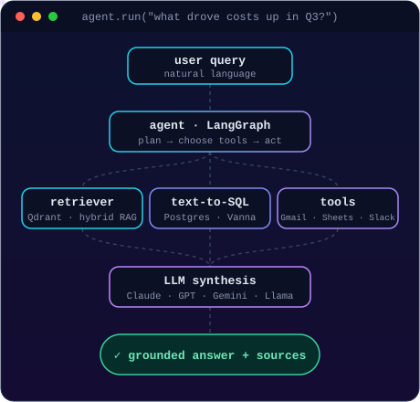

<p align="center">
  
</p>

<p align="center">
  <a href="https://github.com/chaitanya-code24">
    
  </a>
</p>

<p align="center">
  <a href="https://www.linkedin.com/in/chaitanya-lokhande-911343221/"></a>
  <a href="https://portfolio-dusky-seven-11.vercel.app"></a>
  <a href="mailto:chaitanyalokhande2412work@gmail.com"></a>
  
</p>

<br/>

##  About me



I'm an **AI Engineer** from Pune, India. I build the layer where models meet real products.

- 🤖 **Agents**: deterministic, tool-driven agents on LangGraph that *act*: send the email, update the sheet, query the database
- 📚 **RAG**: ingestion, hybrid retrieval and grounded answers over your own documents
- 👁️ **Computer vision**: YOLO on the GPU, streamed in real time over WebSockets
- ⚙️ **Production backends**: FastAPI services with auth, caching, rate limiting and analytics

```python
class Chaitanya:
    role      = "AI Engineer"
    based_in  = "Pune, India 🇮🇳"
    building  = ["LLM agents", "RAG systems", "real-time CV"]
    stack     = ["Python", "FastAPI", "LangGraph", "Next.js"]
    principle = "safe, explainable, measurable AI, not just demos"

    def say_hi(self):
        return "Let's build something intelligent together 🚀"
```

<br clear="right"/>

##  Featured projects

<table>
  <tr>
    <td width="50%" valign="top">
      <h3>🤖 <a href="https://github.com/chaitanya-code24/Orka-AI">Orka AI</a></h3>
      <p>A lightweight framework for <b>action-oriented AI agents</b>: deterministic execution, structured workflows, one interface over OpenAI, Claude, Gemini and Groq, and real connectors for Gmail, Sheets, Notion, HubSpot and Slack.</p>
      
      
      
      <br/><br/>
      <a href="https://github.com/chaitanya-code24/Orka-AI"></a>
    </td>
    <td width="50%" valign="top">
      <h3>💬 <a href="https://github.com/chaitanya-code24/ChatDock">ChatDock</a></h3>
      <p>A platform for <b>document-trained chatbots</b>: multi-bot workspaces, structured ingestion, hybrid RAG over Qdrant, Redis caching and rate limiting, an embeddable widget and API, and usage analytics.</p>
      
      
      
      
      <br/><br/>
      <a href="https://chat-dock.vercel.app"></a>
      <a href="https://github.com/chaitanya-code24/ChatDock"></a>
    </td>
  </tr>
  <tr>
    <td width="50%" valign="top">
      <h3>🦺 <a href="https://github.com/chaitanya-code24/Safety-Detection-System">PPE &amp; Fall Detection</a></h3>
      <p>A <b>real-time safety-compliance vision system</b>. The browser streams sampled frames over one WebSocket, YOLO runs on the GPU, and the client draws overlays from the returned metadata. Includes incident alerts over SMS and email, plus analytics.</p>
      
      
      
      
      <br/><br/>
      <a href="https://real-time-ppe-fall-detection-system.vercel.app"></a>
      <a href="https://github.com/chaitanya-code24/Safety-Detection-System"></a>
    </td>
    <td width="50%" valign="top">
      <h3>🗃️ <a href="https://github.com/chaitanya-code24/AI-Powered-Natural-Language-to-SQL-System">Natural Language → SQL</a></h3>
      <p>Ask a database questions in <b>plain English</b>. It generates SQL, runs it, and returns a summary and an automatic Plotly chart. Verified query pairs persist between runs, and it is benchmarked on 20 questions.</p>
      
      
      
      <br/><br/>
      <a href="https://github.com/chaitanya-code24/AI-Powered-Natural-Language-to-SQL-System"></a>
    </td>
  </tr>
</table>

<details>
  <summary><b>More projects</b></summary>
  <br/>

  - 💸 **[BlinqTrack](https://github.com/chaitanya-code24/BlinqTrack_AI-Expense-Tracker)**: chat with your expenses over RAG, with LLM auto-categorisation (FastAPI · Next.js · MongoDB · Pinecone)
  - 🩺 **[ElderEase](https://github.com/chaitanya-code24/ElderEase-Backend)**: AI nutrition assistant for elderly users with meal plans, medical-report analysis and a chatbot (Node.js · Llama on Groq)
  - 🫁 **[Pneumonia Detection](https://github.com/chaitanya-code24/Pneumonia-Detection-Using-CNN-)**: CNN classifier for chest X-rays
</details>

##  Tech stack

<table>
  <tr>
    <td align="center" width="140"><b>AI / ML</b></td>
    <td>
      <br/>
      
      
      
      
      
      
      
    </td>
  </tr>
  <tr>
    <td align="center"><b>Backend</b></td>
    <td></td>
  </tr>
  <tr>
    <td align="center"><b>Data &amp; vectors</b></td>
    <td>
      <br/>
      
      
    </td>
  </tr>
  <tr>
    <td align="center"><b>Frontend</b></td>
    <td></td>
  </tr>
  <tr>
    <td align="center"><b>Cloud &amp; tools</b></td>
    <td></td>
  </tr>
</table>

##  GitHub activity

<p align="center">
  
  
</p>

<p align="center">
  
</p>

<p align="center">
  <picture>
    <source media="(prefers-color-scheme: dark)" srcset="https://raw.githubusercontent.com/chaitanya-code24/chaitanya-code24/output/github-snake-dark.svg" />
    <source media="(prefers-color-scheme: light)" srcset="https://raw.githubusercontent.com/chaitanya-code24/chaitanya-code24/output/github-snake.svg" />
    
  </picture>
</p>

<p align="center">
  <b>Open to collaborating on AI products, agents and applied ML.</b><br/>
  <a href="https://www.linkedin.com/in/chaitanya-lokhande-911343221/">Let's connect</a> ✨
</p>


